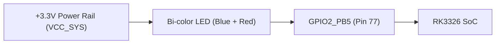
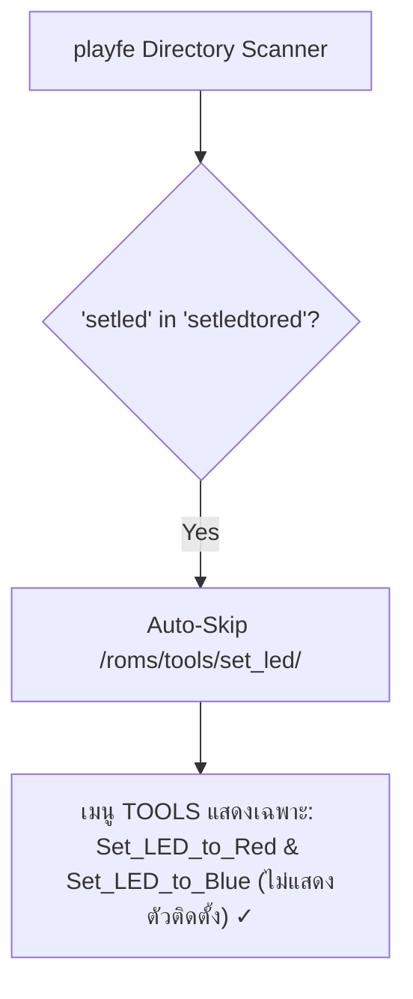

# LED_HARDWARE_GUIDE.md - R36H Status & Power LED Architecture Guide

คู่มือและองค์ความรู้เชิงลึก (Knowledge Base) เกี่ยวกับสถาปัตยกรรมฮาร์ดแวร์ วงจรไฟฟ้า และการควบคุมหลอดไฟสถานะ (Power / Status Indicator LED) บนเครื่องเล่นเกมพกพา **R36H** (`HL-R36H-V20`) ภายใต้ระบบปฏิบัติการ **playOS 4.0** (Linux Kernel `4.4.189`)

---

## 1. ภาพรวมสถาปัตยกรรมฮาร์ดแวร์ (Hardware Architecture)

เครื่อง **R36H** ใช้ชิปประมวลผล **Rockchip RK3326** (ARM64) โดยบริเวณไฟสถานะเปิดเครื่อง (Power Indicator) และเตือนระดับแบตเตอรี่ มีการออกแบบวงจรดังนี้:



### 1.1 ผังคุณสมบัติทางไฟฟ้าและสถานะของขา GPIO
หลอดไฟสถานะของ R36H เป็นแบบ **2-State Bi-color LED (หลอด 2 สีแบบ 2 ขั้วในหลอดเดียว)** ควบคุมผ่านขา **`GPIO2_PB5`** (รหัสพินสากลของเคอร์เนลคือ **`GPIO 77`**) โดยมีพฤติกรรมทางไฟฟ้าดังนี้:

| ค่า Logic ใน sysfs | แรงดันที่ขา GPIO 77 | การไหลของกระแสไฟ | สีไฟที่แสดงผล | ความหมายในระบบ |
| :--- | :--- | :--- | :--- | :--- |
| **`0` (Logic Low)** | `0V` (GND Sink) | กระแสไหลจาก `+3.3V` ผ่านไดโอดสีน้ำเงินลงขา GPIO | **สีน้ำเงิน (Blue)** | ระบบเปิดเครื่องทำงานปกติ (Power ON) |
| **`1` (Logic High)** | `+3.3V` (Source) | แรงดันเท่ากันตัดไฟสีน้ำเงิน และขับไดโอดสีแดงลงกราวด์ | **สีแดง (Red)** | โหมดแบตเตอรี่ต่ำ หรือผู้ใช้เลือกสลับสีไฟ |
| **`in` (Input / Hi-Z)** | ลอยขา (High-Z) | ตัวต้านทาน Pull-down ของวงจรดึงลงกราวด์ | **สีน้ำเงิน (Blue)** | ไฟกลับเป็นสีน้ำเงินตามวงจรฮาร์ดแวร์เดิม |

---

## 2. ทำไมจึงไม่สามารถ "สั่งดับไฟสนิท 100%" ผ่าน Software ได้?

### 2.1 วงจร Direct Totem-Pole (1-Bit, 2-State)
จากการวิเคราะห์วงจรจริง:
* ฮาร์ดแวร์ **ไม่มีทรานซิสเตอร์ตัดตอน (Power-Gating Transistor หรือ Enable Pin แยก)**
* วงจรถูกออกแบบมาให้ขาเดียว (`gpio77`) รับหน้าที่เลือกระหว่าง "น้ำเงิน" หรือ "แดง" เท่านั้น
* ไม่ว่าซอฟต์แวร์จะส่งค่า `0`, `1` หรือสั่งเปลี่ยนทิศทางขาเป็น `in` (Input) วงจรฮาร์ดแวร์ก็จะมีกระแสไหลผ่านหลอดข้างใดข้างหนึ่งเสมอ

### 2.2 ทางออกในทางปฏิบัติ (Workarounds)
1. **ทางเลือกซอฟต์แวร์ (Software Color Switch):**  
   เนื่องจากไฟสีน้ำเงินเดิมมีความสว่างและแสงฟุ้งมากในห้องมืด ผู้เล่นจึงนิยม **สลับเป็นไฟสีแดง** (`gpio77 = 1`) แทน เพราะแสงสีแดงมีความยาวคลื่นที่นุ่มนวลกว่า สบายตากว่า และไม่แยงตาเวลากลางคืน
2. **ทางเลือกกายภาพ (Physical Blackout 100%):**  
   หากต้องการดับไฟมืดสนิทจริง ๆ ต้องแกะฝาหลังตัวเครื่อง แล้วนำ **เทปพันสายไฟสีดำ (Black Electrical Tape)** แปะทับตัวหลอด LED จากด้านใน

---

## 3. ทำความเข้าใจ Dummy Node: `/sys/class/leds/blue:heartbeat`

เมื่อตรวจสอบโฟลเดอร์ `/sys/class/leds/` ใน playOS จะพบโหนด:
```text
/sys/class/leds/blue:heartbeat -> ../../devices/platform/gpio_leds/leds/blue:heartbeat
```

### ทำไมสั่งโหนดนี้แล้วไฟไม่ดับ?
* โหนดนี้ผูกอยู่กับ **`gpio-17`** (`GPIO0_C1`) ซึ่งเป็นมรดกตกทอดมาจาก **Device Tree (`.dtb`) ดั้งเดิม** ของเครื่อง Odroid Go Advance (OGA) และ RG351
* แต่บนบอร์ด **R36H (`HL-R36H-V20`)** ผู้ผลิตไม่ได้ต่อลายวงจรของหลอดไฟเข้ากับขา `gpio-17` จริง
* ดังนั้นการสั่งเปิด/ปิด/ปรับค่าใน `/sys/class/leds/blue:heartbeat` จึงไม่มีผลใดๆ กับหลอดไฟบนตัวเครื่อง

---

## 4. กลไก Background Service ใน playOS (`batt_led.service`)

ในระบบ playOS มีเซอร์วิสคอยจัดการไฟสถานะทำงานอยู่เบื้องหลัง:

```text
batt_led.service (Systemd Service)
    └── ExecStart=/usr/local/bin/batt_life_warning.py
```

### การทำงานของ `batt_life_warning.py`:
1. ตรวจสอบความจุแบตเตอรี่จาก `/sys/class/power_supply/battery/capacity` ทุก ๆ 30 วินาที
2. **หากแบตเตอรี่ > 20%:** สคริปต์จะเขียนค่าที่กำหนด (ปกติคือ `0` = น้ำเงิน) เข้า `/sys/class/gpio/gpio77/value` ซ้ำเพื่อรักษาความสว่าง
3. **หากแบตเตอรี่ <= 20%:** สคริปต์จะสลับเป็นค่าสีแดง หรือกะพริบเพื่อเตือนผู้ใช้

> [!IMPORTANT]
> **การจำค่าสีแบบถาวร (Persistence Across Reboots & Runtime):**  
> หากสั่งเพียงแค่ `echo 1 > /sys/class/gpio/gpio77/value` เมื่อครบ 30 วินาที ตัว `batt_led.service` จะเขียนทับกลับเป็น `0` (สีน้ำเงิน) เหมือนเดิม!  
> การเปลี่ยนสีให้ถาวรและถูกต้องจึงต้องทำ 3 ขั้นตอนพร้อมกัน:
> 1. เขียนค่าเข้า `/sys/class/gpio/gpio77/value` ทันที
> 2. คัดลอกสคริปต์บูต `/usr/local/bin/fix_power_led.red` ทับ `/usr/local/bin/fix_power_led`
> 3. คัดลอกสคริปต์เตือนแบตเตอรี่ `/usr/local/bin/batt_life_warning.py.red` ทับ `/usr/local/bin/batt_life_warning.py` และสั่ง `systemctl restart batt_led`

---

## 5. การผสานรวมเข้ากับเมนู `TOOLS` ของ `playfe` Launcher

ในการนำสคริปต์ไปวางไว้ใน `/roms/tools/` ตัว Launcher ของ playOS (`playfe`) มีกฎการสแกนไดเรกทอรีที่สำคัญคือ **Stem-Matching Auto-Skip Rule**:

### 5.1 ปัญหาเดิมกับโฟลเดอร์ `led_color/`
* ไฟล์สั่งงานด้านนอก: `/roms/tools/Set_LED_to_Red.sh` (Stem: `setledtored`)
* โฟลเดอร์ติดตั้งเดิม: `/roms/tools/led_color/` (Normalized: `ledcolor`)
* เนื่องจาก `"ledcolor"` **ไม่ได้** เป็นคำย่อยของ `"setledtored"` ตัว `playfe` จึงสแกนทะลุเข้าไปในโฟลเดอร์ และดึง `Install_LED_Color.sh` ขึ้นมาแสดงเป็นไอคอนซ้ำในเมนู TOOLS

### 5.2 วิธีแก้ปัญหาด้วยโฟลเดอร์ `set_led/` (Stem-Match Perfect Fit)
เมื่อเปลี่ยนชื่อโฟลเดอร์เป็น **`set_led/`**:
* โฟลเดอร์ `set_led/` $\rightarrow$ แปลงเป็น Normalized Stem: **`"setled"`** (ความยาว 6 ตัวอักษร `> 4`)
* สคริปต์ภายนอก 1: `/roms/tools/Set_LED_to_Red.sh` $\rightarrow$ Normalized Stem: **`"setledtored"`**
* สคริปต์ภายนอก 2: `/roms/tools/Set_LED_to_Blue.sh` $\rightarrow$ Normalized Stem: **`"setledtoblue"`**



ผลลัพธ์คือ **`playfe` จะข้ามการสแกนโฟลเดอร์ `set_led/` โดยสมบูรณ์ตั้งแต่ระดับเคอร์เนลของ Frontend** ทำให้ไฟล์ติดตั้ง (`Install_Set_LED.sh`) ไม่ปรากฏให้เห็นในเมนู TOOLS อย่างแน่นอน 100%

---

## 6. สรุปคำสั่ง Sysfs สำหรับนักพัฒนา (Cheat Sheet)

```bash
# 1. ตรวจสอบสถานะสีไฟปัจจุบัน (0 = น้ำเงิน, 1 = แดง)
cat /sys/class/gpio/gpio77/value

# 2. เปลี่ยนเป็นสีแดงทันที (ชั่วคราว)
sudo sh -c 'echo 1 > /sys/class/gpio/gpio77/value'

# 3. เปลี่ยนเป็นสีน้ำเงินทันที (ชั่วคราว)
sudo sh -c 'echo 0 > /sys/class/gpio/gpio77/value'

# 4. สลับเป็นสีแดงถาวร (รวมระบบเตือนแบตเตอรี่และการบูต)
sudo bash /roms/tools/Set_LED_to_Red.sh

# 5. สลับเป็นสีน้ำเงินถาวร (รวมระบบเตือนแบตเตอรี่และการบูต)
sudo bash /roms/tools/Set_LED_to_Blue.sh
```
