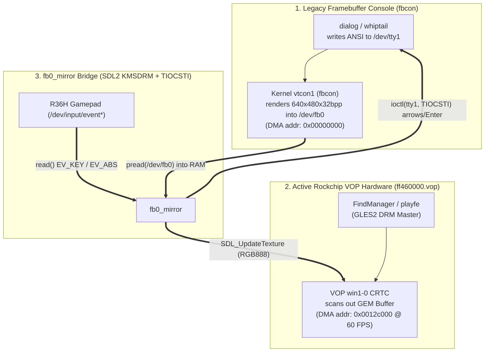

# NCURSES_TUI_GUIDE.md — Running Genuine Linux ncurses TUI (`dialog` / `whiptail`) on R36H (playOS 4.0)

## 1. Executive Summary
On the R36H running **playOS 4.0**, standard Linux ncurses TUI programs (`dialog`, `whiptail`, `alsamixer`, `htop`) written for `/dev/tty1` do **not** appear on screen when launched from **`playOS Terminal` (`FindManager`)** or **`playfe`**, and controller buttons fail to respond.

This guide documents the complete hardware/kernel display architecture discovered on the R36H (`Rockchip RK3326`, kernel `4.4.189`), the **4 critical kernel/SDL2 pitfalls**, and how **[`fb0_mirror`](file:///d:/me/r36h/tools/setup_ui/fb0_mirror.c)** solves all of them so genuine ncurses TUI applications work 100% seamlessly at 60 FPS.

---

## 2. Display Hardware & Kernel Architecture (`Rockchip VOP` vs. `/dev/fb0`)

Inspecting `/sys/kernel/debug/dri/0/summary`, `/sys/class/graphics/fb0/`, and `/opt/FindManager_Data/FindManager` reveals why `/dev/tty1` output is invisible by default:



### Why `dialog > /dev/tty1` Alone Fails in `playOS Terminal`:
1. **`FindManager` Uses `popen(cmd, "r")` Without a PTY:**
   * `FindManager` (`executeTerminalCommand` at `0x17758`, `terminalWorker` at `0x178dc`) runs scripts via `popen(cmd, "r")` and buffers all `stdout` in memory until `pclose()` (process exit), rendering only `"Running.."` at 60 FPS via NanoVG/GLES2.
2. **Rockchip VOP (`win1-0`) Scans Out DRM GEM Buffers, Not `/dev/fb0`:**
   * Even when `dialog` is redirected to `/dev/tty1` (`< /dev/tty1 > /dev/tty1 2>/dev/tty1`), the kernel `fbcon` renders the TUI into `/dev/fb0` (`DMA addr: 0x00000000`), while the hardware display controller (`ff460000.vop`, `win1-0`) remains locked onto `FindManager`/`playfe`'s DRM GEM buffer (`addr: 0x0012c000`).
3. **`chvt` Deadlocks When `playfe` is Stopped (`SIGSTOP`):**
   * `playfe` holds `/dev/tty1` in `VT_PROCESS` mode. Calling `chvt 2` while `playfe` is paused with `SIGSTOP` hangs `chvt` indefinitely waiting for `playfe` to acknowledge the VT release signal (`VT_RELDISP`).

---

## 3. The 4 Technical Pitfalls & How `fb0_mirror` Solves Them

When bridging `/dev/fb0` onto the KMSDRM screen via SDL2, four subtle hardware and driver bugs occur unless explicitly handled:

### Pitfall 1: Black Screen Due to `Alpha = 0` in `/dev/fb0` (`XRGB8888`)
* **Root Cause:** The Linux kernel `fbcon` driver writes 32-bit pixels into `/dev/fb0` (`640×480`, `stride = 2560`) in little-endian `[B, G, R, 0]` format (e.g., ncurses blue background = `[170, 0, 0, 0]`), where the 4th byte (Alpha/`X`) is always **`0`**.
* **Symptom:** If the SDL2 streaming texture is created with `SDL_PIXELFORMAT_ARGB8888`, the OpenGL ES 2.0 shader interprets `Alpha = 0` as **100% transparent**, rendering a completely black screen even though `/dev/fb0` contains the full `dialog` image.
* **Fix:** Create the texture with **`SDL_PIXELFORMAT_RGB888`** (32-bit container ignoring the high byte) and explicitly disable blending:
  ```c
  SDL_Texture *tex = SDL_CreateTexture(rend,
                                       SDL_PIXELFORMAT_RGB888,
                                       SDL_TEXTUREACCESS_STREAMING,
                                       640, 480);
  SDL_SetTextureBlendMode(tex, SDL_BLENDMODE_NONE);
  ```

### Pitfall 2: SDL2 KMSDRM Sets `/dev/tty1` to `KD_GRAPHICS` & Steals `/dev/tty1` Input (`SDL_EVDEV_kbd`)
* **Root Cause:** During `SDL_Init(SDL_INIT_VIDEO)`, SDL2's Linux KMSDRM backend (`SDL_EVDEV_kbd_init`):
  1. Sets `/dev/tty1` to `KD_GRAPHICS` (`1`), which tells the kernel `fbcon` to **stop drawing text into `/dev/fb0`**.
  2. Opens an internal file descriptor to `/dev/tty1`, switches its keyboard mode to `K_MEDIUMRAW` / `K_OFF`, and **calls `read()` on `/dev/tty1` inside every `SDL_PollEvent()` call**—stealing every keystroke before `dialog` can read it!
* **Symptom:** `dialog` appears on screen, but pressing D-Pad or A/B does nothing (`dialog` never receives input).
* **Fix (`detach_sdl_tty_fds`):**
  1. After `SDL_CreateWindow()`, scan `/proc/self/fd` for SDL2's internal `/dev/tty*` file descriptors and redirect them to `/dev/null` via `dup2(null_fd, fd)`.
  2. Do **not** call `SDL_PollEvent()` inside `fb0_mirror`'s loop.
  3. Force `/dev/tty1` back to `KD_TEXT` (`0`) and `K_UNICODE` (`3`):
     ```c
     ioctl(tty_fd, KDSETMODE, KD_TEXT);
     ioctl(tty_fd, KDSKBMODE, K_UNICODE);
     ```

### Pitfall 3: Mali GPU Driver Kernel Deadlock (`D` State) When Passing `mmap("/dev/fb0")` to `SDL_UpdateTexture`
* **Root Cause:** `/dev/fb0` is a `VM_IO | VM_PFNMAP` kernel DMA mapping. Passing an `mmap("/dev/fb0")` pointer directly into `SDL_UpdateTexture()` (`glTexSubImage2D`) causes the Rockchip Mali GLES2 kernel driver to fault/pin the `VM_IO` VMA while holding `mm->mmap_sem`. If the process exits or is killed, it enters uninterruptible sleep (`D` state) in `exit_mmap`, which subsequently causes any `ps aux` or `pkill -f` command (which reads `/proc/<pid>/cmdline` and locks `mmap_sem`) to hang!
* **Fix:**
  1. Never pass `mmap("/dev/fb0")` to OpenGL ES. Allocate a standard heap buffer (`malloc(FB_SIZE)`) and read `/dev/fb0` via **`pread(fb_fd, ram_buf, FB_SIZE, 0)`** (`< 0.3 ms` per frame), then pass `ram_buf` to `SDL_UpdateTexture()`.
  2. Always use **`killall -STOP FindManager playfe`** / **`killall -CONT FindManager playfe`** (which checks `/proc/<pid>/stat` `comm` without locking `mmap_sem`) instead of `pkill -f`.

### Pitfall 4: Capturing `dialog` Output Without Breaking `/dev/tty1` Rendering or `--gauge` Pipes
* **Root Cause:**
  * By default, `dialog` draws its TUI to `stdout` (`fd 1`) and prints the user's selected menu item to `stderr` (`fd 2`).
  * Furthermore, `dialog --gauge` reads percentage updates (`0..100`) from `stdin` (`fd 0`). If `< /dev/tty1` is added to `dialog --gauge`, `/dev/tty1` overrides the pipe and `dialog --gauge` hangs at `0%`.
* **Fix:**
  * For interactive menus (`--menu`, `--radiolist`, `--checklist`, `--inputbox`), attach `fd 0, 1, 2` to `/dev/tty1` and capture the selection via **`--output-fd 3 3>&1 < /dev/tty1 > /dev/tty1 2>/dev/tty1`**.
  * For progress bars (`--gauge`), pipe `stdin` normally and redirect **only** `stdout` and `stderr` to `/dev/tty1` (`> /dev/tty1 2>/dev/tty1`, **no** `< /dev/tty1`).

---

## 4. When to Use `setup_ui` vs. `fb0_mirror` + `dialog`

Both engines are stored centrally in [`setup_ui/`](file:///d:/me/r36h/tools/setup_ui/):

| Feature / Criteria | `setup_ui` ([`setup_ui.c`](file:///d:/me/r36h/tools/setup_ui/setup_ui.c)) | `fb0_mirror` ([`fb0_mirror.c`](file:///d:/me/r36h/tools/setup_ui/fb0_mirror.c)) + Linux `dialog` |
| :--- | :--- | :--- |
| **Rendering Method** | Direct SDL2 KMSDRM vector/bitmap renderer (renders an ncurses-style 3D dialog box natively) | Kernel `fbcon` renders genuine `/usr/bin/dialog` into `/dev/fb0` → streamed to KMSDRM via SDL2 |
| **Configuration Style** | Declarative INI/Block text via `stdin` (`[page]`, `[progress]`, `option = ...`) | Standard Bash `dialog` commands (`dialog --menu`, `--yesno`, `--gauge`, `--msgbox`) |
| **Control Scheme** | Custom R36H scheme: `UP/DOWN` = Option, `LEFT/RIGHT` = `<OK>/<Back>/<Exit>`, `A/B` = Confirm | Standard Linux `dialog` navigation (`UP/DOWN/LEFT/RIGHT`, `A/B` = Enter, `X/Y` = Space, `SELECT` = Tab) |
| **Best Use Case** | New R36H Setup Wizards (`Setup_UI.sh`) needing clean declarative multi-step pages with built-in `[ Back ]` history stack | Running genuine Linux `dialog`/`whiptail` TUI scripts or porting existing ArkOS/XNL `dialog` installers to playOS 4.0 |

---

## 5. Standard Shell Script Template for Real `dialog` TUI (`fb0_mirror`)

Copy [`setup_ui/fb0_mirror`](file:///d:/me/r36h/tools/setup_ui/fb0_mirror) into your tool's subfolder (`app/fb0_mirror` or `daemon/fb0_mirror`) and use this pattern (see [`setup_ui/Demo_Dialog_TUI.sh`](file:///d:/me/r36h/tools/setup_ui/Demo_Dialog_TUI.sh)):

```bash
#!/bin/bash
if [ "$(id -u)" -ne 0 ]; then
    exec sudo -E "$0" "$@"
fi

export SCRIPT_DIR="$(cd "$(dirname "$0")" && pwd)"
MIRROR_BIN="$SCRIPT_DIR/app/fb0_mirror"
MIRROR_PID=""

cleanup_all() {
    if [ -n "$MIRROR_PID" ]; then
        kill -TERM "$MIRROR_PID" 2>/dev/null || true
        wait "$MIRROR_PID" 2>/dev/null || true
    fi
    printf "\033c" > /dev/tty1 2>/dev/null || true
    killall -CONT FindManager playfe 2>/dev/null || true
}
trap cleanup_all EXIT INT TERM

# 1. Freeze FindManager / playfe using killall (never pkill -f)
killall -STOP FindManager playfe 2>/dev/null || true

# 2. Set readable console font on /dev/tty1 and clear screen
setfont /usr/share/consolefonts/Lat7-TerminusBold20x10.psf.gz -C /dev/tty1 2>/dev/null || true
printf "\033c\e[?25l" > /dev/tty1

# 3. Start fb0_mirror in background
"$MIRROR_BIN" >/dev/null 2>&1 &
MIRROR_PID=$!
sleep 0.3

export TERM=linux

# 4. Interactive Menu (--output-fd 3 captures choice while fd 0,1,2 use /dev/tty1)
CHOICE=$(dialog \
    --backtitle "My Tool Installer" \
    --title "Select Action" \
    --ok-label "OK" \
    --cancel-label "Exit" \
    --menu "\nChoose an operation:" 14 54 3 \
    "1" "Install Tool" \
    "2" "Uninstall Tool" \
    "3" "Exit" \
    --output-fd 3 3>&1 < /dev/tty1 > /dev/tty1 2>/dev/tty1)

# 5. Progress Gauge (stdin is the pipe; only stdout/stderr go to /dev/tty1)
if [ "$CHOICE" = "1" ]; then
    (
        echo "50" ; echo "XXX" ; echo "Installing files..." ; echo "XXX" ; sleep 1
        echo "100"; echo "XXX" ; echo "Done!" ; echo "XXX" ; sleep 0.5
    ) | dialog --backtitle "My Tool Installer" --title "Progress" \
        --gauge "\nPlease wait..." 8 50 0 > /dev/tty1 2>/dev/tty1
fi
```
