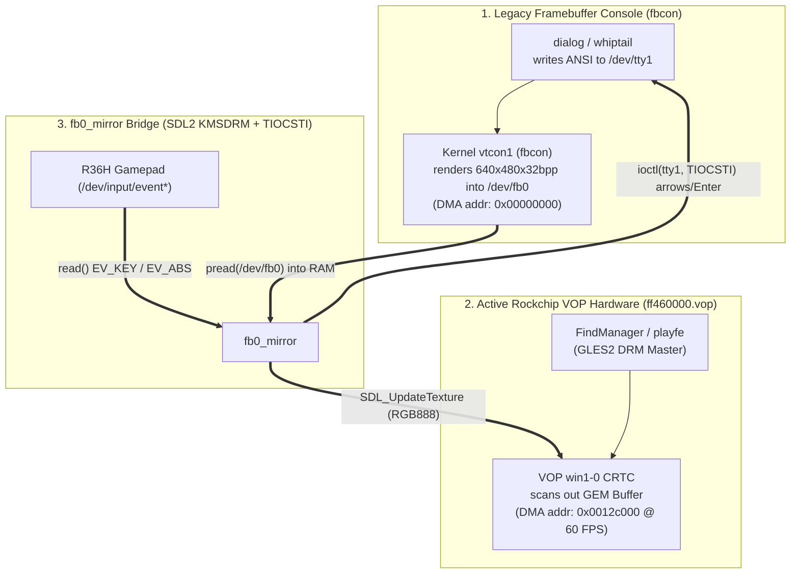

# NCURSES_TUI_GUIDE.md — Running Genuine Linux ncurses TUI (`dialog` / `whiptail`) on R36H (playOS 4.0)

> [!CAUTION] DEPRECATION NOTICE: `fb0_mirror` is DEPRECATED
> **Do NOT use, compile, or bundle `fb0_mirror` in tool suites.**
> On both `playOS` (`playfe`) and `ArkOS` (`emulationstation`), launching a tool script from the menu automatically pauses frontend rendering and grants direct control of `/dev/tty1`. Running an auxiliary framebuffer-capturing daemon (`fb0_mirror`) creates redundant processes, risks TIOCSTI race conditions, and introduces unnecessary failure points.
>
> **Mandatory Modern Standard:**
> - Render terminal user interfaces using genuine Linux `dialog` outputting directly to the text console / `/dev/tty1`.
> - Translate gamepad inputs into console keystrokes using `/opt/inttools/gptokeyb` or `/usr/bin/gptokeyb`.
> - Ensure 100% feature and visual parity between `playOS` and `ArkOS` natively without secondary mirror binaries.

## 1. Executive Summary
On the R36H running **playOS 4.0** or **ArkOS**, interactive setup managers and diagnostic tools use standard Linux ncurses `dialog` rendered directly to the text console (`/dev/tty1`) and controlled via the gamepad using `gptokeyb`.

This guide documents the display architecture, terminal queue management, and the critical pitfalls to prevent glitches like unresponsive D-pads or raw ANSI escape codes (`^[[B`).

---

## 2. Display Hardware & Kernel Architecture (`Rockchip VOP` vs. `/dev/fb0`)

Inspecting `/sys/kernel/debug/dri/0/summary`, `/sys/class/graphics/fb0/`, and `/opt/FindManager_Data/FindManager` reveals why `/dev/tty1` output is invisible by default:



### Why `dialog > /dev/tty1` Alone Fails in `playOS Terminal`:
1. **`FindManager` Uses `popen(cmd, "r")` Without a PTY:**
   * `FindManager` (`executeTerminalCommand` at `0x17758`, `terminalWorker` at `0x178dc`) runs scripts via `popen(cmd, "r")` and buffers all `stdout` in memory until `pclose()` (process exit), rendering only `"Running.."` at 60 FPS via NanoVG/GLES2.
2. **Rockchip VOP (`win1-0`) Scans Out DRM GEM Buffers, Not `/dev/fb0`:**
   * Even when `dialog` is redirected to `/dev/tty1` (`< /dev/tty1 > /dev/tty1 2>/dev/tty1`), the kernel `fbcon` renders the TUI into `/dev/fb0` (`DMA addr: 0x00000000`), while the hardware display controller (`ff460000.vop`, `win1-0`) remains locked onto `FindManager`/`playfe`'s DRM GEM buffer (`addr: 0x0012c000`).
3. **`chvt` Deadlocks When `playfe` is Stopped (`SIGSTOP`):**
   * `playfe` holds `/dev/tty1` in `VT_PROCESS` mode. Calling `chvt 2` while `playfe` is paused with `SIGSTOP` hangs `chvt` indefinitely waiting for `playfe` to acknowledge the VT release signal (`VT_RELDISP`).

---

## 3. The 4 Technical Pitfalls & How `fb0_mirror` Solves Them

When bridging `/dev/fb0` onto the KMSDRM screen via SDL2, four subtle hardware and driver bugs occur unless explicitly handled:

### Pitfall 1: Black Screen Due to `Alpha = 0` in `/dev/fb0` (`XRGB8888`)
* **Root Cause:** The Linux kernel `fbcon` driver writes 32-bit pixels into `/dev/fb0` (`640×480`, `stride = 2560`) in little-endian `[B, G, R, 0]` format (e.g., ncurses blue background = `[170, 0, 0, 0]`), where the 4th byte (Alpha/`X`) is always **`0`**.
* **Symptom:** If the SDL2 streaming texture is created with `SDL_PIXELFORMAT_ARGB8888`, the OpenGL ES 2.0 shader interprets `Alpha = 0` as **100% transparent**, rendering a completely black screen even though `/dev/fb0` contains the full `dialog` image.
* **Fix:** Create the texture with **`SDL_PIXELFORMAT_RGB888`** (32-bit container ignoring the high byte) and explicitly disable blending:
  ```c
  SDL_Texture *tex = SDL_CreateTexture(rend,
                                       SDL_PIXELFORMAT_RGB888,
                                       SDL_TEXTUREACCESS_STREAMING,
                                       640, 480);
  SDL_SetTextureBlendMode(tex, SDL_BLENDMODE_NONE);
  ```

### Pitfall 2: SDL2 KMSDRM Sets `/dev/tty1` to `KD_GRAPHICS` & Steals `/dev/tty1` Input (`SDL_EVDEV_kbd`)
* **Root Cause:** During `SDL_Init(SDL_INIT_VIDEO)`, SDL2's Linux KMSDRM backend (`SDL_EVDEV_kbd_init`):
  1. Sets `/dev/tty1` to `KD_GRAPHICS` (`1`), which tells the kernel `fbcon` to **stop drawing text into `/dev/fb0`**.
  2. Opens an internal file descriptor to `/dev/tty1`, switches its keyboard mode to `K_MEDIUMRAW` / `K_OFF`, and **calls `read()` on `/dev/tty1` inside every `SDL_PollEvent()` call**—stealing every keystroke before `dialog` can read it!
* **Symptom:** `dialog` appears on screen, but pressing D-Pad or A/B does nothing (`dialog` never receives input).
* **Fix (`detach_sdl_tty_fds`):**
  1. After `SDL_CreateWindow()`, scan `/proc/self/fd` for SDL2's internal `/dev/tty*` file descriptors and redirect them to `/dev/null` via `dup2(null_fd, fd)`.
  2. Do **not** call `SDL_PollEvent()` inside `fb0_mirror`'s loop.
  3. Force `/dev/tty1` back to `KD_TEXT` (`0`) and `K_UNICODE` (`3`):
     ```c
     ioctl(tty_fd, KDSETMODE, KD_TEXT);
     ioctl(tty_fd, KDSKBMODE, K_UNICODE);
     ```

### Pitfall 3: Mali GPU Driver Kernel Deadlock (`D` State) When Passing `mmap("/dev/fb0")` to `SDL_UpdateTexture`
* **Root Cause:** `/dev/fb0` is a `VM_IO | VM_PFNMAP` kernel DMA mapping. Passing an `mmap("/dev/fb0")` pointer directly into `SDL_UpdateTexture()` (`glTexSubImage2D`) causes the Rockchip Mali GLES2 kernel driver to fault/pin the `VM_IO` VMA while holding `mm->mmap_sem`. If the process exits or is killed, it enters uninterruptible sleep (`D` state) in `exit_mmap`, which subsequently causes any `ps aux` or `pkill -f` command (which reads `/proc/<pid>/cmdline` and locks `mmap_sem`) to hang!
* **Fix:**
  1. Never pass `mmap("/dev/fb0")` to OpenGL ES. Allocate a standard heap buffer (`malloc(FB_SIZE)`) and read `/dev/fb0` via **`pread(fb_fd, ram_buf, FB_SIZE, 0)`** (`< 0.3 ms` per frame), then pass `ram_buf` to `SDL_UpdateTexture()`.
  2. Always use **`killall -STOP FindManager playfe`** / **`killall -CONT FindManager playfe`** (which checks `/proc/<pid>/stat` `comm` without locking `mmap_sem`) instead of `pkill -f`.

### Pitfall 4: Capturing `dialog` Output & Preventing `--gauge` Pipe Deadlocks
* **Root Causes:**
  1. **Subshell FD Redirection Conflicts:** Using `--output-fd 3 3>&1 1>&2 2>&3 < /dev/tty1 > /dev/tty1` inside `$()` subshells causes standard output redirection collisions with `/dev/tty1`, frequently returning empty strings and triggering unintended fallback options.
  2. **`--gauge` Stdin Override Hang:** `dialog --gauge` reads progress updates (`0..100`, `XXX\nMessage\nXXX`) strictly from `stdin`. Adding `< /dev/tty1` or `< "$DIALOG_IN"` to `dialog --gauge` overrides `stdin`, disconnecting it from the pipe (`|`). The subshell's updates are never consumed, and `dialog` hangs indefinitely at 0% waiting for keyboard input from the terminal!
* **Standard Fixes:**
  * **For Interactive Menus (`--menu`, `--radiolist`, `--checklist`):** Always capture selection to a temporary file:
    ```bash
    dialog ... 2> "$CHOICE_TMP" < "$DIALOG_IN" > "$DIALOG_OUT"
    RET=$?
    SELECTED=$(cat "$CHOICE_TMP" 2>/dev/null | tr -d ' "\r\n')
    rm -f "$CHOICE_TMP"
    ```
  * **For Progress Bars (`--gauge`):** Pipe `stdin` normally and redirect **ONLY** stdout and stderr to the screen:
    ```bash
    (
        echo "25" ; echo "XXX" ; echo "Working..." ; echo "XXX" ; sleep 0.3
        ...
        echo "100"; echo "XXX" ; echo "Done!" ; echo "XXX"
    ) | dialog --gauge "\nPlease wait..." 9 58 0 > "$DIALOG_OUT" 2>/dev/null
    # CRITICAL: NEVER include < "$DIALOG_IN" on dialog --gauge!
    ```

### Pitfall 5: Gamepad Button Mapping Conflict & Dual-Frontend A/B Inversion
* **Root Cause:**
  * If `fb0_mirror.c` maps both Button A (`305`) and Button B (`304`) to `\n` (Enter), users cannot back out, cancel menus, or dismiss dialogs without physical keyboard hardware.
  * Furthermore, different frontends define "Confirm / Cancel" swaps oppositely:
    * **`playfe` (playOS)**: `swap_ab=false` (Off) means `B = OK`, `A = Back` (Western default). `swap_ab=true` (On) means `A = OK`, `B = Back`.
    * **EmulationStation (ArkOS)**: Normal means `A = OK`, `B = Back`. `InvertButtons="true"` or `/var/cache/Switch_AB` means `B = OK`, `A = Back`.
* **Fix (`get_button_mapping`):**
  1. Dynamically inspect the active frontend configuration:
     * **Priority 1 (`playfe`)**: Read `/home/ark/.config/playfe/playfe.cfg`. If present, `swap_ab=true` maps `A (305) = OK, B (304) = Cancel`; otherwise `B (304) = OK, A (305) = Cancel`.
     * **Priority 2 (ArkOS fallback)**: If `playfe.cfg` is absent, check `/home/ark/.emulationstation/es_settings.cfg` (`InvertButtons`) and `/var/cache/Switch_AB`.
  2. For the Cancel button, inject **`\033\033` (Double ESC)** instead of single ESC (`\033`). In Linux `dialog`, double ESC triggers an immediate abort (exit code 1) without waiting for escape sequence timeouts (`ESCDELAY`).

### Pitfall 6: Frontend Restart Deadlock (Never Restart playfe or EmulationStation from Menu Scripts)
* **Root Cause (Parent-Child Deadlock):** When a tool or script is launched from the console's menu (`/roms/ports/` or `/roms/tools/`), it executes as a child process inside the frontend's systemd cgroup (`playfe.service` or `emulationstation.service`).
  * If the script runs `systemctl restart playfe.service` or `systemctl restart emulationstation.service`, `systemctl` synchronously blocks waiting for systemd to restart the service.
  * Meanwhile, systemd waits for all child processes in the active service cgroup (including the script itself) to terminate before starting the service anew!
  * Result: A **90-second systemd deadlock** (`State 'final-sigterm' timed out`), leaving the screen frozen on a cleared black console with a blinking cursor at the top left corner!
* **System Invariant:**
  * In `playOS 4.0`, `playfe` launches scripts with `sudo perfmax ...; nice -n -19 %ROM%; sudo perfnorm`. It automatically pauses rendering and waits synchronously for the child script to exit.
  * The instant the script exits (`exit 0`), `playfe` regains the screen in **0.1 seconds** with zero flickering or delay.
  * Furthermore, `playfe` actively monitors filesystem changes via inotify (`[playfe] library changed on disk: reloaded`), discovering newly added shortcuts and artwork automatically without restarting.
* **Fix:** **Never invoke `systemctl restart` on the frontend service from inside any menu-launched script.** Let the script exit cleanly via `exit 0`.

### Pitfall 7: Avoid `dialog --radiolist` on Handheld Gamepads (Always Use `--menu` + `--default-item`)
* **Root Cause:** In Linux ncurses `dialog`, `--radiolist` requires pressing `Space` to toggle an option's radio dot `(*)`, and then `Enter` to confirm.
  * On handheld game consoles, gamepad bridges like `gptokeyb` map button `A` directly to `Enter`.
  * When a user navigates to an option using the D-Pad and presses `A` (`Enter`) without pressing Space, `dialog` submits whatever item was marked `on` by default (e.g. 10 minutes), completely ignoring the newly highlighted option!
* **Symptom:** User selects "1 Minute" with D-Pad and presses A, but the configuration applies "10 Minutes".
* **Standard Fix:**
  * For single-choice selection on handheld game consoles, **always use `dialog --menu` with `--default-item "$CURRENT_VALUE"`** instead of `--radiolist`.
  * With `--menu`, D-Pad moves the highlight cursor, and pressing `A` (`Enter`) immediately selects and submits that highlighted value.

### Pitfall 8: Raw Escape Sequences (`^[[B`) & Unresponsive D-Pad Due to Orphan Processes
* **Root Cause:** When pressing D-pad Down, `gptokeyb` injects `KEY_DOWN` into `/dev/uinput`, which the kernel keyboard driver translates into ANSI sequence `\033[B` (`^[[B`).
  * If a previous or background instance of `dialog`, `bash`, or `gptokeyb` is lingering on `/dev/tty1`, or if `/dev/tty1` is left in canonical mode (`icanon`) with `echo` on:
    1. The kernel tty line discipline buffers characters waiting for Enter (`\n`), preventing the active `dialog` instance from receiving arrow key events.
    2. The tty driver echoes the raw escape characters straight onto the screen as literal text: `^[[B`.
* **Symptom:** D-pad presses do not move the selection bar, and `^[[B` or `^[[A` appears scattered across the screen.
* **Standard Fix:**
  1. **Kill Orphan Instances on Startup:** Always terminate previous instances of `gptokeyb` and any sibling setup processes before launching the TUI:
     ```bash
     pkill -9 -f "gptokeyb.*$SCRIPT_NAME" 2>/dev/null || true
     ```
  2. **Direct Invocation (No Subshell Function Wrapper):** Call `dialog` directly with standard I/O redirection:
     ```bash
     dialog ... 2> "$CHOICE_TMP" < "$DIALOG_IN" > "$DIALOG_OUT"
     ```
     Avoid wrapping `dialog` inside a bash helper function that nests redirection (`dialog "$@" < "$DIALOG_IN" > "$DIALOG_OUT"` with external `2> "$CHOICE_TMP"`), which can scramble termios descriptor bindings.
  3. **Clean Teardown:** Ensure `trap cleanup EXIT INT TERM HUP` restores terminal visibility and cursor state:
     ```bash
     printf "\033c\e[?25h" > /dev/tty1 2>/dev/null || true
     ```

---

## 4. Action Completion & Exit Lifecycle Standard

When designing interactive setup wizards and managers:

1. **Install and Uninstall (One-Shot Actions):**
   * Upon successful completion, display the summary dialog (`dialog --msgbox`) with: `Press A or Enter to exit.`
   * When the user confirms with `A`, call **`exit 0` directly**, returning control immediately to `playfe`.
2. **Configuration (Single-Config vs Multi-Config):**
   * **Single-Config Tool (only 1 setting, e.g. `Screen Off` which only has "Config TimeOut"):**
     * Adjusting this single setting completes the user's intent. Display the summary dialog with `Press A or Enter to exit.` and **`exit 0` directly**.
   * **Multi-Config Tool (offers $\ge 2$ configuration settings):**
     * Adjusting one setting should display `Press A or Enter to continue.` and **return to the Main Setup Menu**, allowing the user to configure additional settings in the same session without having to re-launch the tool from the frontend.
     * The user exits when finished by selecting the menu's `Exit` option (or Button `B` / Cancel).
3. **Cancellation (Button B / Cancel / Back):**
   * Pressing Cancel/Back in sub-dialogs must always return to the Setup Menu to allow selecting another option.

---

## 5. When to Use `setup_ui` vs. `fb0_mirror` + `dialog`

Both engines are stored centrally in [`setup_ui/`](file:///d:/me/r36h/tools/setup_ui/):

| Feature / Criteria | `setup_ui` ([`setup_ui.c`](file:///d:/me/r36h/tools/setup_ui/setup_ui.c)) | `fb0_mirror` ([`fb0_mirror.c`](file:///d:/me/r36h/tools/setup_ui/fb0_mirror.c)) + Linux `dialog` |
| :--- | :--- | :--- |
| **Rendering Method** | Direct SDL2 KMSDRM vector/bitmap renderer (renders an ncurses-style 3D dialog box natively) | Kernel `fbcon` renders genuine `/usr/bin/dialog` into `/dev/fb0` → streamed to KMSDRM via SDL2 |
| **Configuration Style** | Declarative INI/Block text via `stdin` (`[page]`, `[progress]`, `option = ...`) | Standard Bash `dialog` commands (`dialog --menu`, `--yesno`, `--gauge`, `--msgbox`) |
| **Control Scheme** | Custom R36H scheme: `UP/DOWN` = Option, `LEFT/RIGHT` = `<OK>/<Back>/<Exit>`, `A/B` = Confirm | Dynamic OS-aware navigation (`UP/DOWN/LEFT/RIGHT`, `A/B` = Dynamic OK/Cancel matching playfe or ArkOS, `X/Y` = Space, `SELECT` = Tab) |
| **Best Use Case** | New R36H Setup Wizards (`Setup_UI.sh`) needing clean declarative multi-step pages with built-in `[ Back ]` history stack | Running genuine Linux `dialog`/`whiptail` TUI scripts or porting existing ArkOS/XNL `dialog` installers to playOS 4.0 |

---

## 6. Standard Shell Script Template for Real `dialog` TUI (`fb0_mirror`)

Copy [`setup_ui/fb0_mirror`](file:///d:/me/r36h/tools/setup_ui/fb0_mirror) into your tool's subfolder (`app/fb0_mirror` or `daemon/fb0_mirror`) and use this pattern (see [`setup_ui/Demo_Dialog_TUI.sh`](file:///d:/me/r36h/tools/setup_ui/Demo_Dialog_TUI.sh)):

```bash
#!/bin/bash
if [ "$(id -u)" -ne 0 ]; then
    exec sudo -E "$0" "$@"
fi

export SCRIPT_DIR="$(cd "$(dirname "$0")" && pwd)"
MIRROR_BIN="$SCRIPT_DIR/app/fb0_mirror"
MIRROR_PID=""

cleanup_all() {
    if [ -n "$MIRROR_PID" ]; then
        kill -TERM "$MIRROR_PID" 2>/dev/null || true
        wait "$MIRROR_PID" 2>/dev/null || true
    fi
    printf "\033c" > /dev/tty1 2>/dev/null || true
    killall -CONT FindManager playfe 2>/dev/null || true
}
trap cleanup_all EXIT INT TERM

# 1. Freeze FindManager / playfe using killall (never pkill -f)
killall -STOP FindManager playfe 2>/dev/null || true

# 2. Set readable console font on /dev/tty1 and clear screen
setfont /usr/share/consolefonts/Lat7-TerminusBold20x10.psf.gz -C /dev/tty1 2>/dev/null || true
printf "\033c\e[?25l" > /dev/tty1

# 3. Start fb0_mirror in background
"$MIRROR_BIN" >/dev/null 2>&1 &
MIRROR_PID=$!
sleep 0.3

export TERM=linux

# 4. Interactive Menu (--output-fd 3 captures choice while fd 0,1,2 use /dev/tty1)
CHOICE=$(dialog \
    --backtitle "My Tool Installer" \
    --title "Select Action" \
    --ok-label "OK" \
    --cancel-label "Exit" \
    --menu "\nChoose an operation:" 14 54 3 \
    "1" "Install Tool" \
    "2" "Uninstall Tool" \
    "3" "Exit" \
    --output-fd 3 3>&1 < /dev/tty1 > /dev/tty1 2>/dev/tty1)

# 5. Progress Gauge (stdin is the pipe; only stdout/stderr go to /dev/tty1)
if [ "$CHOICE" = "1" ]; then
    (
        echo "50" ; echo "XXX" ; echo "Installing files..." ; echo "XXX" ; sleep 1
        echo "100"; echo "XXX" ; echo "Done!" ; echo "XXX" ; sleep 0.5
    ) | dialog --backtitle "My Tool Installer" --title "Progress" \
        --gauge "\nPlease wait..." 8 50 0 > /dev/tty1 2>/dev/tty1
fi
```
