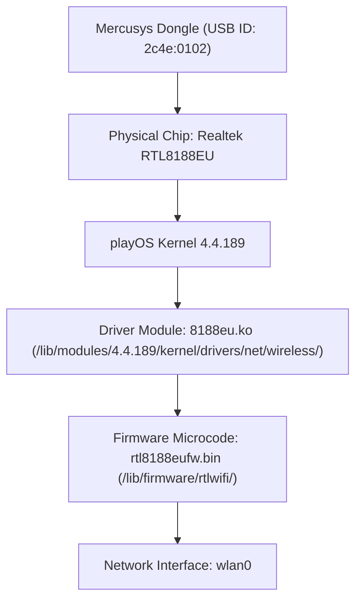
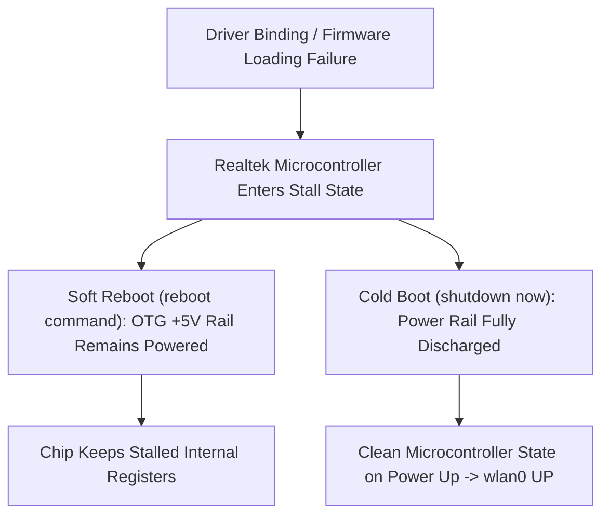

# WIFI_HARDWARE_GUIDE.md - R36H Realtek Wi-Fi Driver & Hardware Architecture Guide

Technical reference and hardware architecture guide for USB Wi-Fi dongles (specifically Realtek RTL8188EU / Mercusys MW150US) on the **R36H Handheld Gaming Console** running **playOS** (Linux Kernel `4.4.189` / ARM64).

---

## 1. Hardware & System Environment

* **Target Device:** R36H Handheld Gaming Console
* **SoC / Architecture:** Rockchip RK3326 (ARM64 / ARMv8 / aarch64)
* **Operating System:** playOS (Linux Kernel `4.4.189`)
* **Target Peripheral:** Mercusys USB Wi-Fi Dongle (Model: MW150US)
* **USB Vendor & Product ID:** `2c4e:0102 Mercusys INC 802.11n NIC`
* **Physical Wi-Fi Chipset:** Realtek **RTL8188EU** / **RTL8188EUS**



---

## 2. Chipset Differentiation: RTL8188EU vs. RTL8188FU

A common pitfall on playOS is mistaking the RTL8188EU for an RTL8188FU device due to kernel output:

| Attribute | Built-in `rtl8188fu` | Mercusys MW150US (`8188eu`) |
| :--- | :--- | :--- |
| **Kernel Status** | Built-in (`=y`, statically linked) | External Kernel Module (`8188eu.ko`) |
| **USB IDs Supported** | `0bda:f179`, Realtek FU vendor IDs | `2c4e:0102`, `0bda:8179`, `0bda:0179` |
| **Module Loading** | Cannot `modprobe` (compiled `=y`) | Loaded via `modprobe 8188eu` or `insmod` |
| **Required Firmware** | Internal / kernel firmware | `/lib/firmware/rtlwifi/rtl8188eufw.bin` |

> [!WARNING] Do Not Force Bind to `rtl8188fu`
> The playOS kernel contains a built-in driver named `rtl8188fu` (`usbcore: registered new interface driver rtl8188fu`, compiled with `=y`). Because it is built-in, attempting `modprobe rtl8188fu` returns an error.
> The Mercusys dongle (`2c4e:0102`) is **NOT** RTL8188FU; it is an **RTL8188EU** device. **Never force-bind `2c4e:0102` to `rtl8188fu`**, as doing so locks up the USB controller. The correct module is **`8188eu.ko`**.

---

## 3. Root Cause of HAL Ops Error & Verified Firmware

During driver testing, loading `8188eu.ko` without firmware causes the following kernel error in `dmesg`:

```text
RTW: #### rtw_hal_ops_check - Error : Please hook hal_func.set_hw_reg_handler ####
RTW: #### rtw_hal_ops_check - Error : Please hook hal_func.GetHwRegHandler ####
```

### 3.1 Root Cause Analysis
* **Mechanism:** The Realtek driver initializes HAL operation function pointers dynamically when loading the firmware microcode. When the firmware file (`rtl8188eufw.bin`) is missing from `/lib/firmware/rtlwifi/rtl8188eufw.bin` or corrupted, HAL initialization terminates prematurely. This leaves essential function pointers (`set_hw_reg_handler`, `GetHwRegHandler`) as null pointers, triggering `rtw_hal_ops_check` failure.
* **Resolution:** Ensure the correct firmware file is present in `/lib/firmware/rtlwifi/rtl8188eufw.bin` prior to inserting the kernel module.

### 3.2 Verified Binary Artefacts

| File Name | Target Destination | File Size | MD5 Checksum |
| :--- | :--- | :--- | :--- |
| **`rtl8188eufw.bin`** | `/lib/firmware/rtlwifi/rtl8188eufw.bin` | `15,262 bytes` | `b66178b87ed8f917997b9cf38fc0cfd3` |
| **`8188eu.ko`** | `/lib/modules/4.4.189/kernel/drivers/net/wireless/8188eu.ko` | `1,167,320 bytes` | `959e7febc4be3bf6909fa877de7809b1` |

> [!NOTE] Native Module Alias
> The compiled `8188eu.ko` driver contains `alias: usb:v2C4Ep0102d*` compiled natively into its modinfo table. Once registered in the kernel module database via `depmod -a`, the kernel automatically associates the Mercusys USB ID `2c4e:0102` with `8188eu` on hotplug without needing manual modprobe parameters.

---

## 4. Hardware Stall & Cold Boot Requirement

Realtek USB Wi-Fi chips contain internal microcontrollers that exhibit stateful latching behavior:



### Key Behaviors:
1. **USB Microcontroller Stall:** If initialization fails or an improper driver is bound, the dongle's internal state machine enters a hardware stall.
2. **Soft Reboot Ineffective:** A software reload (`rmmod`/`modprobe`) or soft reboot (`reboot`) does **not** cut physical power to the OTG port. The chip remains in the locked state.
3. **Cold Boot Requirement:** A full power cycle (`shutdown now`) cuts power to the OTG port, completely draining chip capacitors and resetting the dongle to a clean state.
